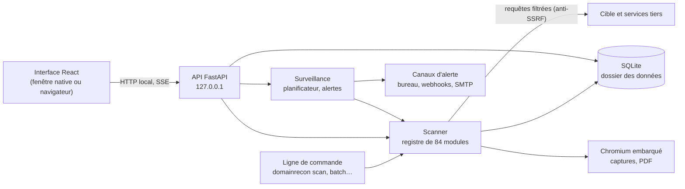

# Architecture

DomainRecon est une application Python (FastAPI) qui sert une interface React. Le même processus fait
tourner le serveur local, le scanner et la surveillance ; une fenêtre native (WebView2 sous Windows,
WebKitGTK sous Linux) ou le navigateur affiche l'interface.

## Vue d'ensemble



## Déroulé d'un scan

1. L'API reçoit le domaine et le profil, vérifie l'autorisation pour les modules actifs ou sensibles et crée
   une tâche de fond.
2. Le scanner choisit les modules du profil dans le registre, puis les lance par vagues (un module peut
   dépendre du résultat d'un autre), chacun avec son délai.
3. Chaque module renvoie un résultat JSON et son statut réel (`ok`, `failed`, `timeout`, `skipped`).
   L'avancement part en direct vers l'interface (Server-Sent Events).
4. Les règles des modules produisent les constats et les critères du score ; les familles et la note sont
   calculées.
5. Le scan est enregistré. Les messages sont stockés sous forme de codes et traduits à la lecture (français
   ou anglais).

## Modules

Un module est un fichier de `domainrecon/scanner/modules/` qui déclare un `ModuleSpec` : famille, catégorie,
clés d'API, vague, délai, règles de constats et de score. Ses textes (aide, « Comprendre et corriger ») sont
dans `domainrecon/i18n/modules/<clé>.fr.json` et `.en.json`. Les modules sont découverts automatiquement ; un
test de contrat vérifie chacun d'eux. Le détail est dans le [contrat des modules](contrat-modules.md).

## Organisation du dépôt

```text
DomainRecon/
├── domainrecon/           paquet Python (commande domainrecon)
│   ├── api/               application FastAPI, routes, tâches et SSE, sécurité
│   ├── cli/               sous-commandes : scan, batch, history, export, modules, import, monitor
│   ├── core/              chemins, configuration, base de données, modèles
│   ├── desktop/           lanceur : serveur, fenêtre native ou navigateur
│   ├── i18n/              textes français et anglais, dont ceux des modules
│   ├── monitor/           tableau de bord, comparaison, lots, surveillance, tâche système
│   ├── notify/            canaux d'alerte : notifications, bureau, webhooks, SMTP
│   ├── reports/           rapports JSON, CSV, Markdown, HTML, PDF, SARIF, JUnit
│   └── scanner/           registre, modules, familles, constats, score
├── frontend/              interface React, Vite, TypeScript (construite dans domainrecon/web/)
├── packaging/             construction des livrables : PyInstaller, Inno Setup, paquet .deb
├── tests/                 tests pytest, rangés par domaine
├── docs/                  documentation
└── .github/               intégration continue, publication, modèles de tickets
```

Dossiers générés, jamais versionnés :

| Dossier | Contenu |
|---|---|
| `domainrecon/web/` | Interface construite par `npm run build`. |
| `private/build/` | Travail de construction : PyInstaller, Chromium de Playwright, dossier de l'application. |
| `private/data/` | Données d'un lancement depuis les sources. |
| `release/<version>/` | Livrables finaux, `SHA256SUMS` et `NOTES.md`. |
