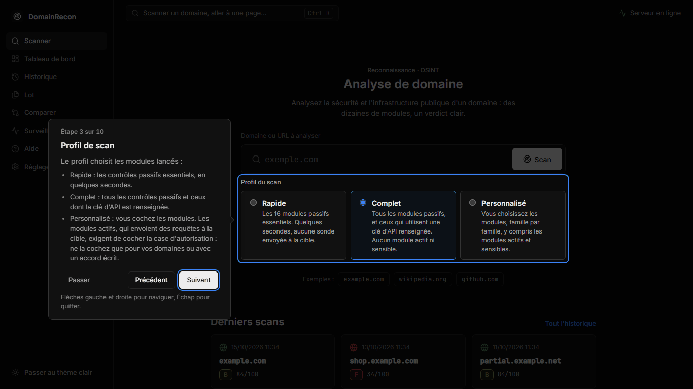
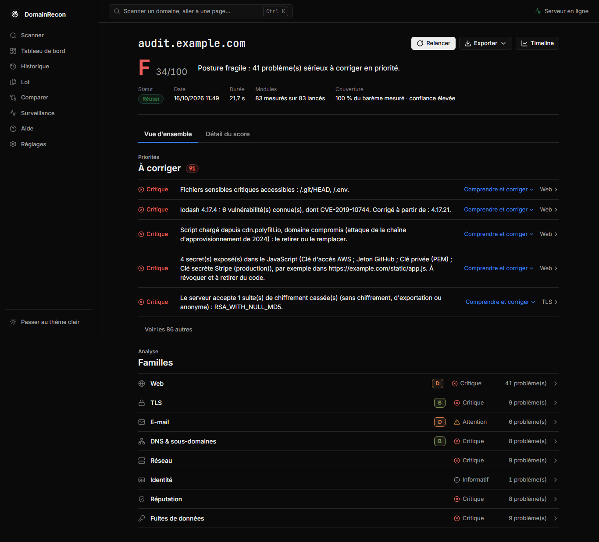
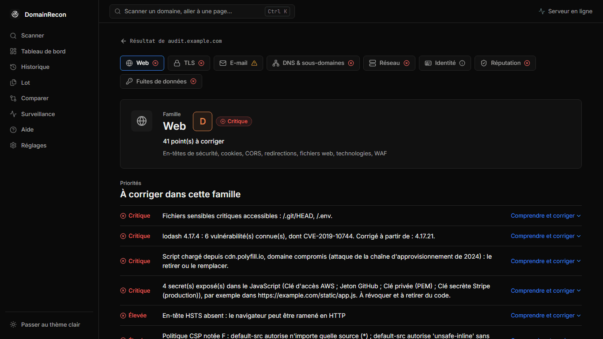
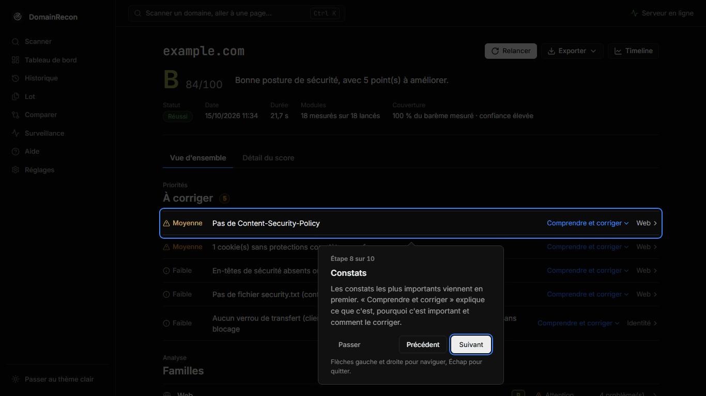

# Guide d'utilisation

Ce guide suit le parcours habituel : lancer un scan, lire le résultat, corriger, exporter. L'interface
existe en français et en anglais ; la langue se change dans **Réglages** et s'applique aussi aux scans déjà
faits.

> N'analysez que des domaines que vous administrez ou que vous êtes autorisé à tester. Un scan contacte la
> cible et interroge des services tiers.

## L'interface

Le menu latéral donne accès aux écrans ; Ctrl+K ouvre la palette de commandes (aller à une page, lancer un
scan, relancer la visite guidée).

| Écran | Rôle |
|---|---|
| Scanner | Saisir un domaine, choisir un profil, lancer le scan. Derniers scans. |
| Tableau de bord | Vos domaines, leur note, sa tendance, les constats par gravité, l'état de la surveillance. |
| Historique | Tous les scans, recherche, filtres par note et par statut. Timeline d'un domaine. |
| Lot | Plusieurs domaines d'un coup. Voir [Lot et comparaison](lot-et-comparaison.md). |
| Comparer | Différences entre deux scans d'un même domaine. |
| Surveillance | Scans réguliers et alertes. Voir [Surveillance et alertes](surveillance.md). |
| Aide | Guide, profils, cadre légal, FAQ et glossaire. |
| Réglages | Clés d'API, délais, capture d'écran, proxy, canaux d'alerte, thème, langue, données. |

Les termes techniques ont une infobulle partout dans l'interface.

## Lancer un scan

1. Sur l'écran **Scanner**, saisissez un domaine ou une URL : `example.com`, `blog.example.com` ou
   `https://example.com/page`. Le sous-domaine saisi est bien celui qui est analysé.
2. Choisissez un profil (voir ci-dessous).
3. Cliquez sur **Scan**. Le résultat se remplit en direct, famille par famille, avec une barre
   d'avancement et un bouton **Annuler**.

## Profils et autorisation

| Profil | Modules lancés |
|---|---|
| Rapide | Les 16 modules passifs essentiels. Quelques secondes, aucune sonde envoyée à la cible. |
| Complet (par défaut) | Tous les modules passifs, et ceux qui utilisent une clé d'API renseignée. Aucun module actif ni sensible. |
| Personnalisé | Les modules que vous cochez, famille par famille, y compris les modules actifs et sensibles. |

Chaque module porte un badge de catégorie : **passif**, **actif**, **clé d'API** ou **sensible** (détail dans
[Modules](modules.md)). Un module actif (scan de ports, brute-force de sous-domaines, fichiers sensibles…)
ou sensible (fuites, secrets) n'est lancé que si vous cochez **J'ai l'autorisation de tester cette cible**.
Ne cochez cette case que pour vos domaines ou avec un accord écrit du propriétaire. Le serveur vérifie
lui-même cette autorisation : un scan qui la demande sans l'avoir est refusé.

## Lire le résultat

- **Note** de A à F et **score** sur 100. Le barème est détaillé dans [Score de sécurité](score.md).
- **Couverture** : part du barème qui a pu être mesurée. Sous 50 %, la note vaut `N/A` : mieux vaut aucune
  note qu'une note trompeuse.
- **À corriger** : les constats triés par gravité (critique, élevée, moyenne, faible, informatif).
- **Familles** : une ligne par famille (Web, TLS, E-mail, DNS et sous-domaines, Réseau, Identité, Réputation,
  Fuites de données), avec sa note et son nombre de problèmes.
- **Détail du score** : les points obtenus critère par critère.
- Actions : **Relancer**, **Exporter**, **Timeline** (évolution du domaine).

Un module en échec, hors délai ou sans objet est affiché comme tel. Il n'est jamais présenté comme « rien
trouvé », et son critère sort du calcul de la note au lieu de compter comme réussi.

### Une famille en détail

Cliquez sur une famille pour ouvrir sa page : les constats de la famille, puis un onglet par module avec
son statut réel, ses mesures et ses tableaux. Certaines familles ont des vues propres : carte réseau (DNS),
carte géographique (Réseau), WHOIS, capture d'écran, notes et tags (Identité). La carte du monde est
embarquée : elle fonctionne hors ligne.

## Comprendre et corriger

Chaque constat a un volet **Comprendre et corriger** :

- ce que c'est, et pourquoi c'est important ;
- les étapes de correction propres au module, sous forme de liste numérotée ;
- souvent un extrait de configuration à copier, avec une variante par plateforme (nginx, Apache…) ;
- un lien vers la documentation officielle.

Ces textes existent en français et en anglais pour chacun des 84 modules.

## Exporter un rapport

Le bouton **Exporter** produit le rapport du scan affiché :

| Format | Usage |
|---|---|
| PDF | Rapport à transmettre, avec les étapes de correction. |
| HTML | Rapport autonome, lisible dans un navigateur. |
| Markdown | Rapport à coller dans un ticket ou un wiki. |
| CSV | Constats dans un tableur. |
| JSON | Données complètes du scan, pour un script. |
| SARIF | Import dans un outil d'analyse de code (GitHub code scanning). |

La ligne de commande ajoute le format JUnit, pour une intégration continue. Le PDF est produit par le
Chromium embarqué.

## Visite guidée

Au premier lancement, un court accueil rappelle l'usage autorisé et propose une visite. Elle surligne chaque
élément de l'interface et l'explique : recherche et Ctrl+K, champ domaine et bouton Scan, profils, menu,
Réglages, Aide, puis l'écran de résultat (note, constats et « Comprendre et corriger », familles, Exporter)
s'il existe déjà un scan.

Les flèches, Entrée et Échap la pilotent ; **Plus tard** ou **Passer** la referment. Elle se relance depuis
**Aide > Relancer la visite guidée**, ou par Ctrl+K (« visite », « tuto »).

## Notes, tags et historique

- Sur la page Identité d'un scan, ajoutez des notes et des tags pour retrouver vos audits.
- **Historique** : recherche, filtres par note et par statut, pagination.
- **Timeline** d'un domaine : courbe du score, changements DNS, domaines liés.

## Importer une ancienne base

**Réglages** permet d'importer une base SQLite d'une version antérieure de DomainRecon (`.db`) : barre de
progression, puis bilan (scans lus, importés, doublons ignorés). Les captures d'écran ne sont pas reprises.
Même chose en ligne de commande : `domainrecon import ancienne_base.db`.
